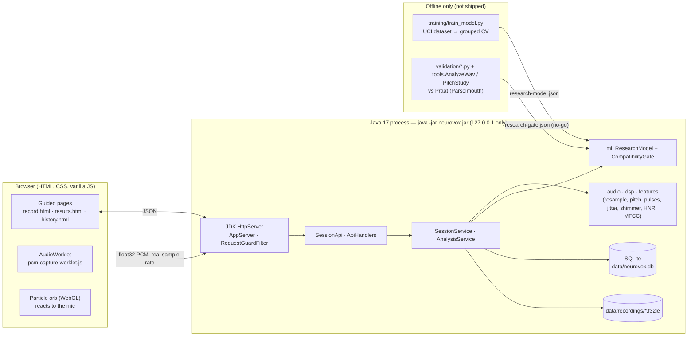

# Architecture

Neurovox is one Java 17 process. It serves the website, stores data in a local SQLite file, and does all acoustic
analysis and model inference in Java. The browser only captures audio, shows instructions and draws results.
Python exists only offline (training and validation) and is never called by the app.

## The big picture



## Package and class map

| Package | Classes | Responsibility |
|---|---|---|
| `com.neurovox` | `Main`, `AppOptions` | Start-up: parse `--port`/`--data-dir`, open data folder, start server, wait for Ctrl+C |
| `server` | `AppServer`, `ServerConfig`, `RequestGuardFilter`, `SafeHandler`, `SecurityHeaders`, `StaticFileHandler`, `StaticPath`, `MimeTypes`, `SessionApi`, `ApiHandlers`, `JsonViews`, `Json`, `HttpError`, `QueryParams`, `RequestBodies` | HTTP: routes, guards (Host, Origin, sizes), static files, JSON shapes, errors |
| `session` | `SessionService`, `SessionDetails`, `NotFoundException` | Profiles, sessions, attach/replace/delete recordings; keeps files and rows consistent |
| `db` | `Database`, `Migrations`, `Timestamps`, `ProfileRepository`, `SessionRepository`, `VoiceSampleRepository`, `SpeechFeatureRepository`, `SampleAnalysisRepository`, `ScreeningResultRepository`, `DataAccessException` | SQLite connections, transactions, versioned schema, one repository per table |
| `storage` | `LocalData`, `RecordingStore`, `FilePermissions` | The data folder; atomic recording files with SHA-256; owner-only permissions |
| `model` | `TaskType`, `LocalProfile`, `RecordingSession`, `VoiceSample`, `SpeechFeatures`, `FeatureValue`, `ScreeningResult` | Plain domain records with validation |
| `audio` | `AudioClip`, `PcmDecoder`, `PcmSummary`, `WavCodec`, `Resampler`, `SignalOps`, `WindowFunction`, `Framer`, `InvalidAudioException` | Bytes → samples, WAV I/O, anti-aliased resampling, DC removal, pre-emphasis, windows, frames |
| `dsp` | `PitchDetector`, `AutocorrelationPitchDetector`, `YinPitchDetector`, `PitchSettings`, `PitchContour`, `FrameLayout`, `Interpolation`, `PulseExtractor`, `PulseTrain` | F0 per frame (two methods), individual glottal pulses |
| `features` | `UciFeature`, `JitterMeasures`, `ShimmerMeasures`, `HarmonicityMeasures`, `F0Statistics`, `MfccExtractor`, `FeatureCatalog` | The 16 UCI measures in fixed order, MFCC, plain-language descriptions |
| `analysis` | `RecordingAnalyzer`, `QualityGate`, `QualityReport`, `LevelProfile`, `SteadyRegion`, `RecordingAnalysis`, `AnalysisService`, `SessionReport` | One take → quality + features; one session → stored report; history |
| `ml` | `ResearchModel`, `ModelLoader`, `CompatibilityGate`, `ResearchIndicator` | Load exported model, logistic regression, the recorded go/no-go decision |
| `tools` | `AnalyzeWav`, `PitchStudy` | Command-line tools for the validation studies (same code as the app) |

Frontend (`src/main/resources/static/js/`): `record.js` (guided flow), `recorder-audio.js` + `pcm-capture-worklet.js`
(capture), `api.js` (all network calls), `results.js`, `history.js`, `chart.js`, `ui.js`, `features.js`, `tasks.js`;
the orb: `orb.js`, `orb-page.js`, `shaders.js`, `geometry.js`, `fallback.js`, `voice-input.js`, `audio-analysis.js`;
landing page: `main.js`.

## HTTP API

| Method and path | Purpose |
|---|---|
| `GET /api/health` | server is up |
| `GET /api/tasks` | the four tasks: code, order, target/min/max seconds |
| `GET /api/sessions` | history: sessions newest first, with vowel measurements; the 16-feature catalogue |
| `POST /api/sessions` | start a session (default local profile) |
| `GET /api/sessions/{id}` | session and its recordings |
| `DELETE /api/sessions/{id}` | delete a session, its files and results |
| `PUT /api/sessions/{id}/recordings/{task}?sampleRate=…` | upload one take (raw float32 PCM) → quality gate → stored, or 422 with recovery advice |
| `GET /api/sessions/{id}/recordings/{task}/audio.wav` | the take as 16-bit WAV (for Praat) |
| `POST /api/sessions/{id}/analysis` | analyse a complete session → report |
| `GET /api/sessions/{id}/report` | stored report (409 if not analysed) |
| `GET /api/model` | model version, feature order, evaluation summary, gate decision |
| `DELETE /api/data` with `{"confirm":"delete all"}` | delete all local data |

Every error has the shape `{"error": {"status", "code", "message"}}`; a rejected take adds `"quality"` with every check.

## Request to result: one session, step by step

```mermaid
sequenceDiagram
  participant B as Browser (record.js)
  participant S as SessionApi
  participant Q as RecordingAnalyzer + QualityGate
  participant SS as SessionService
  participant A as AnalysisService
  participant D as SQLite + files
  B->>S: POST /api/sessions
  S->>SS: startSession(defaultProfile)
  SS->>D: INSERT recording_sessions
  loop four tasks
    B->>S: PUT /recordings/{task}?sampleRate=48000 (float32 bytes)
    S->>S: PcmDecoder.decodeF32le (little-endian, finite, |x| ≤ 4)
    S->>Q: check(task, clip) — resample, pitch, loudness, clipping, voicing
    alt quality FAIL
      S-->>B: 422 audio_quality + message + recovery
    else PASS / WARN
      S->>SS: attachRecording → RecordingStore.write (temp + rename, SHA-256)
      SS->>D: INSERT voice_samples (replaces earlier take), mark complete after 4th
      S-->>B: 201 recording + quality
    end
  end
  B->>S: POST /api/sessions/{id}/analysis
  S->>A: analyze(id)
  A->>D: read each file, verify SHA-256
  A->>Q: analyze(task, clip) ×4
  Note over Q: vowel: native-rate pitch → steady region → pulses → jitter, shimmer, HNR/NHR, F0; MFCC at 16 kHz<br/>speech tasks: voicing, pitch variability, pauses, syllable rate, MFCC
  A->>D: one transaction: speech_features + sample_analyses (+ screening_results only if gate = go)
  A-->>S: SessionReport (indicator: not shown + reason)
  S-->>B: 200 report JSON → results.html
```

## Design decisions worth defending

- **JDK `HttpServer`, not Spring Boot:** every route is visible in `AppServer.start`; nothing happens by annotation.
- **One short-lived SQLite connection per unit of work**, foreign keys on per connection, WAL journal, versioned
  migrations; deleting a session cascades to samples, features and results, then the files are removed.
- **Raw float32 storage** of exactly what the browser captured, at its real sample rate; WAV only for export.
- **Quality gate before storage**, so bad audio never becomes a stored “result”.
- **Two analysis rates:** native (≤ 48 kHz) for cycle timing, as Praat does; anti-aliased 16 kHz for MFCC and speech.
- **Fixed feature order** in `UciFeature`, checked again when the model is loaded; unmeasurable values are stored
  as “unavailable + reason”, never NaN or a substitute.
- **The scientific gate is data, not code:** `research-gate.json` decides; the code path for “go” exists and is tested.
- **Library boundary:** JTransforms computes the FFT only; Gson and sqlite-jdbc are plumbing. Every acoustic feature,
  both pitch detectors, the resampler and the inference are our own Java.
