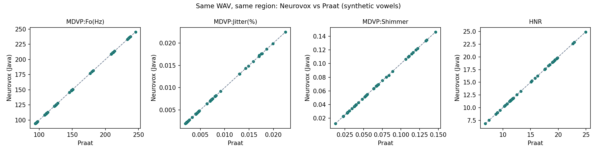
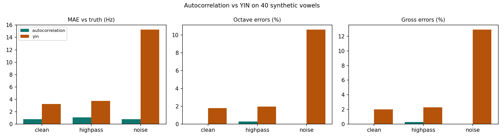

# Validation

What has been checked, the actual numbers, what they do and do not show, and what is still missing.
Every number here comes from a script in the repository; the generated tables are in [`results/`](results/).
Nothing in this file is a placeholder.

| Question | Evidence | Status |
|---|---|---|
| Do the Java formulas compute what they claim? | 174 JUnit tests on signals with known answers | **Yes**, within stated tolerances |
| Does Java agree with Praat on the same audio? | 40 synthetic vowels, 16 measurements | **Yes** — relative MAE ≤ 0.15 %, r = 1.000 |
| Does Java agree with Praat on human voices? | — | **Not tested: no human recordings were available** |
| Are our values on the scale of the dataset’s MDVP columns? | — | **Unknown; cannot be tested with the dataset alone** |
| Does the research model generalise to new people? | Subject-grouped cross-validation on 32 subject codes | **Weakly**: 69.2 % accuracy, below the 75.4 % baseline |
| Does Java inference equal scikit-learn? | 21 dataset rows | **Yes**, to < 1e-9 |
| Which pitch detector should be used? | 40 vowels × 3 conditions × 2 detectors | **Autocorrelation** (more accurate and robust; YIN 16× faster) |
| Scientific gate for live inference | All of the above | **NO-GO** — the classifier stays an offline result |

---

## 1. Unit-level checks (Java, `./mvnw test`)

Key known-answer tests (all pass; see the test classes for exact tolerances):

| Area | Test | Result |
|---|---|---|
| Resampling | 1 kHz sine, 48 → 16 kHz: frequency and amplitude kept (±1 %) | pass |
| Anti-aliasing | 10 kHz sine, 48 → 16 kHz: the 6 kHz alias is **> 60 dB** down; naive decimation leaves it at full strength | pass |
| Non-integer ratio | 440 Hz, 44.1 → 16 kHz vs the analytic sine: max error < 1e-3 | pass |
| Framing / windows | 16 000 samples, 512/256 → 61 frames; Σ Hamming(512) = 0.54·512 − 0.46 | pass |
| Pitch | Sine and harmonic-rich sawtooth at 90–400 Hz within 0.5 %; strong 2nd harmonic → no octave error; silence → unvoiced; white noise → < 10 % voiced (both detectors) | pass |
| Pulses | Periodic vowel at 48 kHz: one pulse per cycle; mean period exact to 1e-7 s; steady cycles within 5.2 µs | pass |
| Jitter | Hand-worked periods (10,11,10,11,10 ms) give the exact local, RAP, PPQ5; DDP = 3·RAP exactly | pass |
| Jitter recovery | Injected 0.5 / 1 / 2 % period noise recovered within 20 % (slight under-estimate, as Praat) | pass |
| Shimmer | Hand-worked amplitudes give exact local, dB, APQ3; DDA = 3·APQ3 exactly | pass |
| HNR | Sine + white noise at 5/10/20 dB SNR → HNR within 1 dB of the SNR; pure sine > 20 dB and finite | pass |
| MFCC | 13 finite coefficients; flat log spectrum → all zero; mel(1000 Hz) ≈ 1000 | pass |
| Unmeasurable | Silent vowel → all 16 values “unavailable” with a reason, never NaN or a guess | pass |
| Quality gate | Silence, very quiet, clipped, too short, noise-only, 8 kHz rate → rejected with a recovery message | pass |

Two defects were found and fixed during this validation and are worth knowing for the viva:

1. **Fractional drift in pulse tracking.** The first implementation located each next pulse relative to the
   *rounded* sample of the previous one, so every period lost its fractional part (369.0 instead of 369.23 samples).
   Praat adds the measured shift to the exact time; `PulseExtractor` now does the same. This changed jitter on a
   noisy synthetic vowel from 0.61 % to 0.216 % (Praat: 0.216 %).
2. **Analysis rate for timing.** At 16 kHz one sample is 62.5 µs, comparable to the cycle-length differences jitter
   measures. The vowel’s period analysis now runs at the native rate (≤ 48 kHz), as Praat does; the anti-aliased
   16 kHz copy is used for MFCC and the speech tasks. (A variant that moved pulses onto sinc-interpolated waveform
   peaks was tried and dropped: it was more sensitive to noise.)

## 2. Java versus Praat (`validation/praat_compare.py`)

**Method.** 40 synthetic sustained /a/ vowels (44.1 kHz, 3.5 s; F0 95–250 Hz; period noise 0.2–2.5 %; amplitude
noise 1–10 %; additive noise at 12–35 dB SNR) from `validation/make_synthetic_vowels.py`. For each file, Neurovox
(`com.neurovox.tools.AnalyzeWav`, the same code as the app) chooses the steady region; Praat 6.1.38 (through
Parselmouth 0.4.7, which embeds Praat’s C++ code) analyses **the same file and the same region** with the same settings:
To Pitch (ac) [0.01 s, 75–600 Hz, 15 candidates, silence 0.03, voicing 0.45, octave 0.01, octave-jump 0.35,
voiced/unvoiced 0.14], To PointProcess (cc), Voice report [period factor 1.3, amplitude factor 1.6].

**Results** (full table: [`results/praat_comparison.md`](results/praat_comparison.md); paired values per file:
[`results/praat_comparison.csv`](results/praat_comparison.csv)):

| Feature | Java mean | Praat mean | Bias (J−P) | Relative MAE | Pearson r |
|---|---|---|---|---|---|
| MDVP:Fo(Hz) | 151.6689 | 151.6686 | +0.0002 Hz | 0.00 % | 1.0000 |
| MDVP:Jitter(%) | 0.0089 | 0.0089 | +2.7e-6 | 0.12 % | 1.0000 |
| MDVP:RAP | 0.0051 | 0.0050 | +2.1e-6 | 0.15 % | 1.0000 |
| MDVP:Shimmer | 0.0678 | 0.0679 | −6.6e-5 | 0.11 % | 1.0000 |
| NHR | 0.0725 | 0.0725 | −2.0e-5 | 0.12 % | 1.0000 |
| HNR | 14.549 dB | 14.543 dB | +0.006 dB | 0.07 % | 1.0000 |
| all 16 | | | | ≤ 0.15 % | 1.0000 |

Against the known truth (closure-to-closure periods), Java and Praat have the **same** error: both under-read local
jitter by 0.14 %-points on average (r = 0.956 with the truth). Cross-correlation pulse tracking compares one-period
windows that overlap neighbouring cycles, which smooths the largest perturbations.

**What this shows:** the Java code implements Praat’s definitions faithfully. **What it does not show:**
(a) behaviour on human voices (synthetic vowels are cleaner and more regular; r = 1.000 partly reflects their wide,
designed spread); (b) compatibility with the training data (§4).

**Missing evidence:** the plan called for about 20 human sustained vowels. To add them: record with the app, download
each vowel from its report (**Download vowel WAV**), place the files in `validation/recordings/` (never committed),
and rerun `praat_compare.py`; the “Human set” section of the generated report fills in automatically.

## 3. Autocorrelation versus YIN (Sprint I; `com.neurovox.tools.PitchStudy`)

Same 40 vowels, three conditions: as recorded; 4th-order 300 Hz high-pass (removes the fundamental — the classic
octave-error trap); white noise at 6 dB SNR. Both detectors run on the 16 kHz copy with the same floor/ceiling; the
autocorrelation detector includes Praat-style Viterbi path tracking, YIN follows the paper’s steps 1–5.
Full tables: [`results/pitch_study.md`](results/pitch_study.md).

| Condition | Detector | MAE vs truth | Octave errors | Gross errors (> 20 %) | MAE vs Praat | ms per s of audio |
|---|---|---|---|---|---|---|
| clean | autocorrelation | 0.77 Hz | 0.00 % | 0.00 % | 0.07 Hz | 48.7 |
| clean | YIN | 3.25 Hz | 1.80 % | 1.99 % | 2.26 Hz | 3.0 |
| high-pass | autocorrelation | 1.06 Hz | 0.29 % | 0.29 % | — | 46.2 |
| high-pass | YIN | 3.74 Hz | 1.96 % | 2.28 % | — | 3.0 |
| noise 6 dB | autocorrelation | 0.79 Hz | 0.00 % | 0.00 % | — | 30.9 |
| noise 6 dB | YIN | 15.27 Hz | 10.61 % | 12.92 % | — | 3.5 |

Does the choice propagate? Local jitter computed with pulses guided by each detector (same files, same region,
same pulse code): median shift 0.15 % (clean), 0.40 % (high-pass), 6.1 % (noise); **maximum 50 %, 69 % and 224 %**
on individual files, where YIN’s octave jumps break the pulse tracking.

**Finding:** the detector at the bottom of the stack can change the jitter value at the top by a factor of two or
more on a bad recording, while leaving clean recordings almost untouched. Neurovox uses the autocorrelation detector.
Timing: median of 10 runs after 3 warm-up runs, Apple M4, Java 21; YIN is about 16× faster here (our autocorrelation
evaluates every lag directly and refines each candidate with sinc interpolation).

## 4. Compatibility with the training data

The UCI columns carry **MDVP** names (Kay Pentax Multi-Dimensional Voice Program). The dataset contains features only:
no audio and no extraction settings, so we cannot run our code, Praat or MDVP on the original recordings. Observations:

- Scales match in kind: the dataset stores jitter/shimmer as **fractions** despite the “(%)” in `MDVP:Jitter(%)`
  (healthy median 0.0034), and `Jitter:DDP / MDVP:RAP` = 3.0005 (range 2.989–3.013), `Shimmer:DDA / Shimmer:APQ3` = 3.000
  — consistent with Praat-style definitions where DDP = 3·RAP.
- But some definitions certainly differ: MDVP’s NHR is a spectral energy ratio (Deliyski 1993), while ours (and
  Praat’s) is the autocorrelation ratio (1 − r)/r. Microphones, rooms and the original analysis settings are unknown.
- Therefore agreement with Praat is necessary but **not sufficient** for using the trained model on live recordings.

## 5. Research model (Sprint F; `training/train_model.py`)

Oxford Parkinson’s dataset (UCI, CC BY 4.0, DOI 10.24432/C59C74): 195 recordings. The description says 31 people
(23 PD); the `name` column contains **32 distinct subject codes (24 PD, 8 healthy)** — grouping uses the codes as given.
Model: StandardScaler + LogisticRegression (C = 1, lbfgs), 16 features in the fixed order, threshold 0.5.
Full results and fold composition: [`results/model_evaluation.md`](results/model_evaluation.md).

| Evaluation | Accuracy | Balanced accuracy | Sensitivity | Specificity | ROC-AUC |
|---|---|---|---|---|---|
| **Subject-grouped 5-fold (primary)** | **69.2 %** | **57.1 %** | 81.0 % | 33.3 % | **0.622** |
| Grouped 5-fold, 20 shuffles | 72.4 % ± 2.8 % | | | | 0.656 ± 0.047 |
| Leave-one-subject-out | 73.8 % | 61.6 % | 85.7 % | 37.5 % | 0.660 |
| Per subject (grouped 5-fold, mean output) | 71.9 % | 60.4 % | 83.3 % | 37.5 % | 0.635 |
| Naive recording split — **leaky, comparison only** | 80.5 % | 69.5 % | 91.2 % | 47.9 % | 0.820 |
| Always predict “PD” (baseline) | 75.4 % | 50 % | 100 % | 0 % | — |

- No subject appears in both training and test data in any grouped fold (asserted by the script). In the naive split
  all 5 test folds contained people whose other recordings were in training (123 overlaps).
- Fold 1 of the primary split contains no healthy subject (8 healthy subjects cannot fill 5 folds), so its ROC-AUC
  is undefined and reported as n/a.
- **Interpretation:** the leaky split adds 11 accuracy points and 0.2 AUC — that is voice memorisation, not disease
  detection. The honest grouped accuracy is below the majority baseline; with 16 features and 32 people the model
  carries little information. Coefficients should not be read one by one: RAP and DDP (and APQ3 and DDA) are exact
  multiples, so their weights split arbitrarily.
- **Java inference** (`ResearchModel`): on 21 dataset rows the Java output equals scikit-learn’s `predict_proba` to
  < 1e-9 (`ModelAgreementTest`). Feature order is checked when the model is loaded.

## 6. Scientific gate: NO-GO for live inference

Recorded in [`src/main/resources/model/research-gate.json`](../src/main/resources/model/research-gate.json) on
2 Oct 2026, and shown on every report. Reasons: (1) Praat agreement only on synthetic vowels; (2) no way to show
agreement with the MDVP columns; (3) the model itself is weak under subject-grouped evaluation. The app therefore
shows the acoustic report only; the classifier remains an offline research result. The code path for a “go”
decision exists and is tested (`AnalysisApiTest.indicatorIsShownAndStoredOnlyWhenTheGateSaysGo`), so a future team
with human-recording evidence can change the decision file without code changes. The output would be labelled as an
experimental research indicator — never a diagnosis, a probability of disease or “clinical confidence”.

## 7. End-to-end check (browser → Java → SQLite → report)

`scripts/recorder-check.mjs` drives headless Chrome with a synthetic vowel as the microphone through the whole
guided journey, then every failure path. Last run (2 Oct 2026): all steps passed; no console errors; all
172 requests went to the local server only; no horizontal overflow at 390 px width. The demo voice was synthesised
with 0.5 % period noise (expected local jitter ≈ 0.56 %); the browser-to-Java pipeline reported 0.57 %.

## 8. Unresolved limitations

- No human voices in any validation; synthetic vowels have a simple source and fixed formants.
- MDVP compatibility unknown (§4); NHR definitions differ.
- The model was trained on 32 people, English-language recordings, one recording setup; it is not validated on
  anyone else. Medication state, age, sex, microphone and room are uncontrolled confounds.
- Quality-gate thresholds and the speech heuristics (pauses, syllable rate) are engineering choices, not validated
  against annotated speech.
- The six nonlinear features (RPDE, D2, DFA, spread1, spread2, PPE) are not computed and are never substituted.

## Sources

1. Boersma, P. (1993). Accurate short-term analysis of the fundamental frequency and the harmonics-to-noise ratio of
   a sampled sound. *IFA Proceedings* 17, 97–110.
2. Boersma, P. & Weenink, D. *Praat: doing phonetics by computer* (version 6.1.38 used; manual pages “Voice 2. Jitter”,
   “Voice 3. Shimmer”; source files `VoiceAnalysis.cpp`, `AmplitudeTier.cpp`, `PointProcess.cpp`,
   `Pitch_to_PointProcess.cpp`, read for definitions only).
3. Jadoul, Y., Thompson, B. & de Boer, B. (2018). Introducing Parselmouth: A Python interface to Praat.
   *Journal of Phonetics* 71, 1–15.
4. de Cheveigné, A. & Kawahara, H. (2002). YIN, a fundamental frequency estimator for speech and music.
   *J. Acoust. Soc. Am.* 111(4), 1917–1930.
5. Little, M. A., McSharry, P. E., Roberts, S. J., Costello, D. A. E. & Moroz, I. M. (2007). Exploiting nonlinear
   recurrence and fractal scaling properties for voice disorder detection. *BioMedical Engineering OnLine* 6:23.
6. Little, M. A., McSharry, P. E., Hunter, E. J. & Ramig, L. O. (2009). Suitability of dysphonia measurements for
   telemonitoring of Parkinson’s disease. *IEEE Trans. Biomedical Engineering* 56(4).
7. Little, M. (2007). Parkinsons [Dataset]. UCI Machine Learning Repository. https://doi.org/10.24432/C59C74 (CC BY 4.0).
8. Deliyski, D. (1993). Acoustic model and evaluation of pathological voice production. *Proc. Eurospeech ’93*.
9. Rosenberg, A. E. (1971). Effect of glottal pulse shape on the quality of natural vowels. *J. Acoust. Soc. Am.* 49, 583–590.
10. Davis, S. & Mermelstein, P. (1980). Comparison of parametric representations for monosyllabic word recognition.
    *IEEE Trans. ASSP* 28(4); Young, S. et al. *The HTK Book* (mel filterbank and DCT conventions).
11. Smith, J. O. *Digital Audio Resampling Home Page*, CCRMA, Stanford (bandlimited interpolation).
12. Pedregosa, F. et al. (2011). Scikit-learn: Machine learning in Python. *JMLR* 12, 2825–2830.
